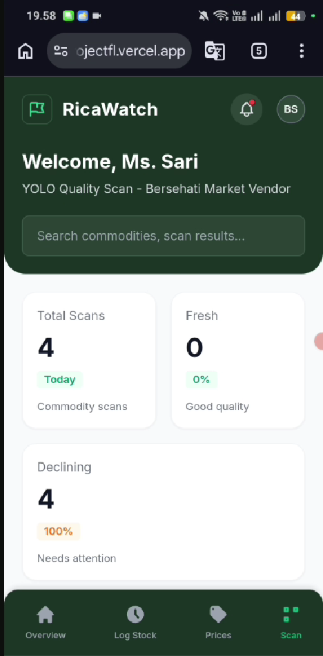
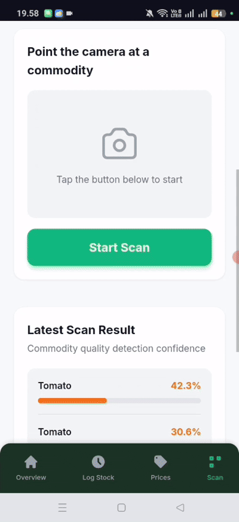
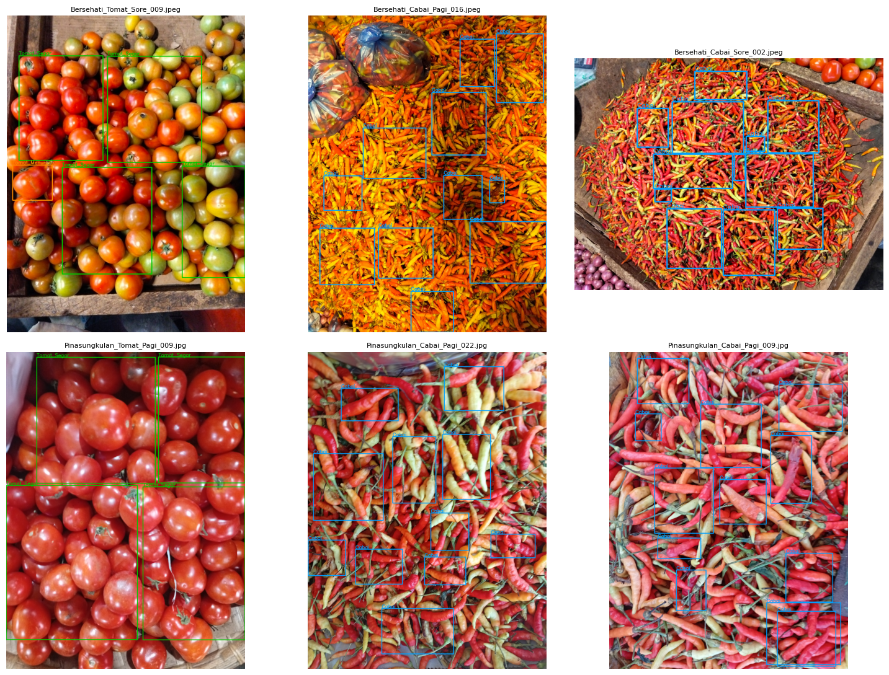
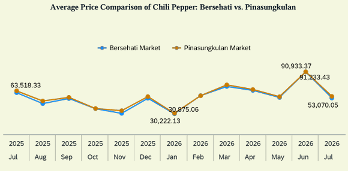
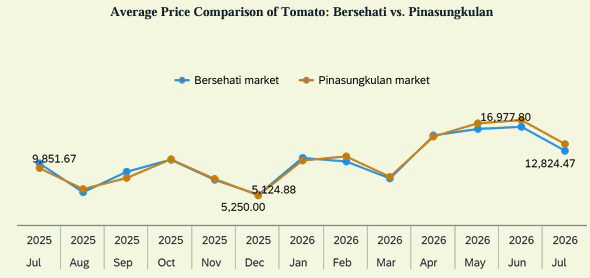
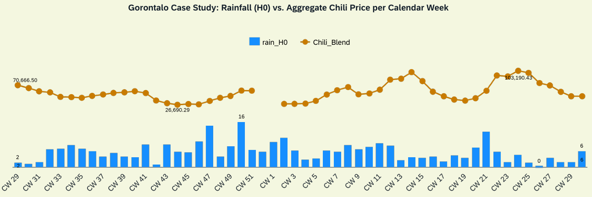
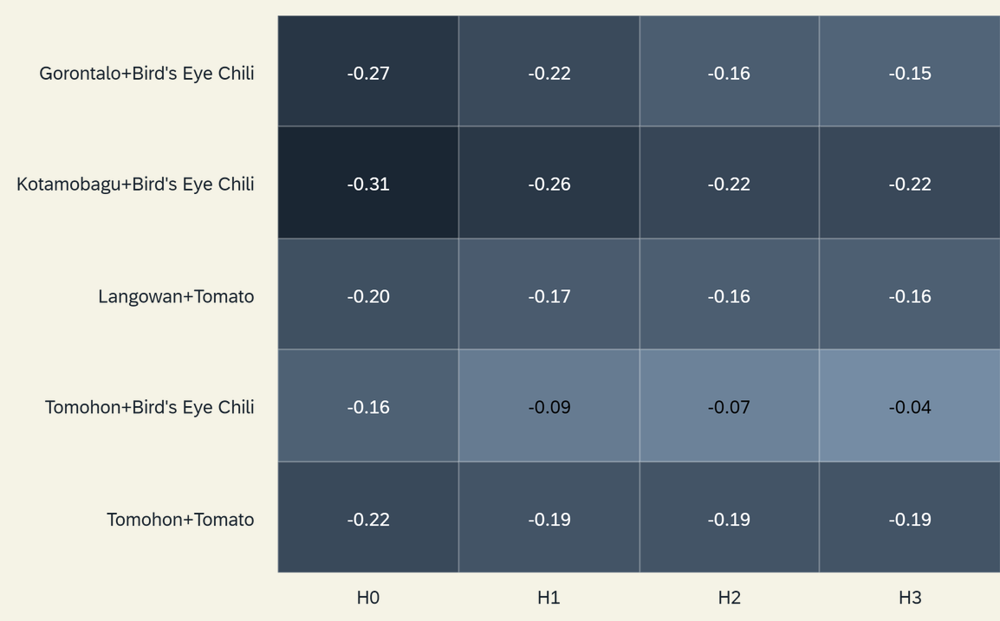
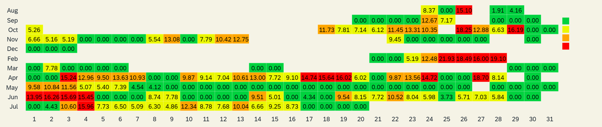
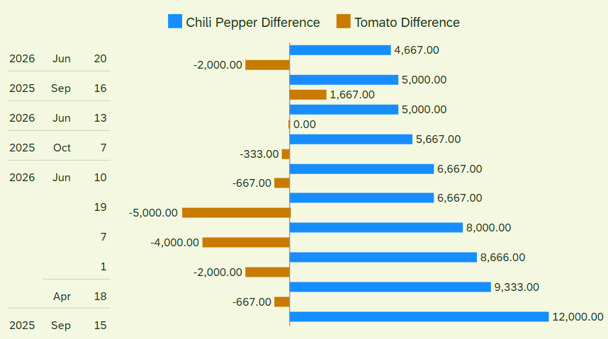

<h1 align="center">🍅 RicaWatch: AI-Powered Food Loss Prediction & Redistribution System</h1>
<p align="center"><b>From Loss to Logic: AI-Driven Food Redistribution for Indonesia and ASEAN</b></p>
<p align="center">Early-warning oversupply scoring and real-time quality checks for tomatoes and chili in Manado's traditional markets.</p>

<p align="center">
  
  
  
  
  
</p>

---

## 🧩 Project Summary

**RicaWatch** is a multi-layer AI system built by **Team Dollar Warrior** for the **ASEAN Data Science Explorers 2026** (SAP × ASEAN Foundation). It helps vendors and market managers at **Bersehati** and **Pinasungkulan** markets (Manado) anticipate oversupply and act before red bird's eye chili and tomatoes spoil, **without needing cold-chain infrastructure**.

Three layers work together: **time-series risk scoring**, **YOLOv8 computer vision**, and **OCR** for paper stock records. Critical alerts trigger same-day surplus redistribution through Perumda Pasar Manado and surplus-food partners.

> **Pilot / demo.** The YOLOv8 model (pilot v2) is still early. The percentage shown in the app is model *confidence*, not accuracy. Interface mockups use illustrative data.

| Problem | Impact (Bersehati pilot, moderate scenario) |
|---|---|
| Indonesia's horticultural loss exceeds 60%, costing an estimated Rp 213–551 trillion per year | 20% loss reduction ≈ **10.2 tons saved** and **~Rp 584 million per year** from one market |

---

## 🎬 Demo

<p align="center">
  <a href="https://drive.google.com/file/d/1M6SpHSmBTVHKIMyZ9SNU1Wzk9WgGmU5Q/view?usp=drive_link">
    
  </a>
</p>
<p align="center"><i>Click the image to watch the full demo on YouTube</i></p>

<p align="center">
  
</p>
<p align="center"><i>Live scan preview: tomato and chili detection with YOLOv8</i></p>

---

## 🏗 Technical Methodology

The project follows **CRISP-DM**.

| Phase | What we did |
|---|---|
| **Business Understanding** | Aligned with SDG 12.3, 2.4, 13.3 and the ASEAN AIFS framework; validated through 14+ vendor interviews and meetings with Perumda Pasar Manado. |
| **Data Understanding** | 283 daily price records (1,055 observations) from Jul 2025 to Jul 2026, plus NASA POWER rainfall for four supplier regions. |
| **Data Preparation** | Pivoted prices, parsed weather files, interpolated gaps of ≤ 7 days, built rain lags (H0–H3) and ISO-week datasets. |
| **Modeling** | CRITIC-weighted oversupply risk score and YOLOv8 freshness detection. |
| **Evaluation** | Weather–price correlation tests, risk-score distribution, and impact estimation. |
| **Deployment** | Vercel frontend, FastAPI + YOLOv8 in Docker on AWS EC2, exposed via Cloudflare Tunnel. |

### 📊 Datasets Used
| Data Name | Source | Key Variables | Role |
|----------|-------|----------------|-------|
| Commodity Prices | North Sulawesi Food Security Agency (manually compiled) | Daily price per kg, two markets, two commodities | Primary Predictor |
| Rainfall | NASA POWER | `PRECTOTCORR` for Gorontalo, Kotamobagu, Tomohon, Langowan | Weather Predictor |
| Produce Images | Team field collection | `Tomat_Segar`, `Tomat_Menurun`, `Cabai` | YOLOv8 Training |
| Stall Data & Interviews | Perumda Pasar Manado, vendor interviews | 207 active stalls, 1.04 kg/day loss per vendor | Impact Estimation |

---

## 👤 My Contributions (Team Lead)

As team lead, I was responsible for:

- 🗂️ **Storyboard & Timeline:** Built the storyboard and the project timeline for the August–October 2026 work period.
- 📈 **Data Collection:** Collected food price data from July 2025 to July 2026 from the Facebook page of the North Sulawesi Food Security Agency (**283 daily records, 1,055 price observations** across two markets and two commodities), then prepared it for analysis in SAP Analytics Cloud.
- 🎤 **Field Research:** Interviewed Perumda Pasar Manado (together with Christian) and vendors at Bersehati Market, while collecting chili and tomato photos for computer vision.
- 💻 **Web Application:** Built the web application with a computer vision feature (YOLOv8).
- 📊 **Data Visualization:** Created and refined data visualizations in SAP Analytics Cloud.

---

## 👥 Team Contributions

### 🔹 1. Data Analysis & Preprocessing (`analysis/`)
- **Price Cleaning:** Standardized commodity names and built a wide price table per market.
- **Gap Handling:** Interpolated gaps of up to 7 days only; longer gaps stay empty (*null ≠ 0*).
- **Weather Pipeline:** Auto-detected NASA POWER headers and created daily rain with lag features.
- **Correlation Analysis:** Weekly Pearson tests across 5 commodity-region pairs and 4 lags. Only 1 of 20 combinations was significant, so weather alone cannot explain price swings.

### 🔹 2. Risk Score & Computer Vision
- **Oversupply Risk Score:** `0.305 × Trend + 0.335 × Weather + 0.359 × Volatility`, with weights from the CRITIC method. Scores map to Low / Medium / High / Critical, each tied to a recommended action.
- **YOLOv8 Detector:** Classes `Tomat_Segar`, `Tomat_Menurun`, `Cabai`. In v2, fresh and declining chili are merged, so chili is only *detected*, not graded.

### 🔹 3. Web App & Deployment
- **Live Scan:** Phone camera sends one frame at a time to `POST /api/scan`; the app draws boxes and averages the last 5 frames to avoid flicker.
- **Infrastructure:** Docker on EC2, Cloudflare Tunnel (no open AWS ports), CORS and rate limiting.

---

## 🧠 Results

| Pair | Best r (H0) | Significant? |
|---|---|---|
| Kotamobagu + Chili | −0.31 | Yes (p = 0.025) |
| Gorontalo + Chili | −0.27 | No (p = 0.054) |
| Tomohon + Tomato | −0.22 | No |
| Langowan + Tomato | −0.20 | No |
| Tomohon + Chili | −0.16 | No |

**Estimated impact at Bersehati** (≈135 chili/tomato vendors × 1.04 kg/day × 365 = 51.2 tons lost per year):

| Scenario | Reduction | Saved per year |
|---|---|---|
| Conservative | 15% | 7.7 tons |
| **Moderate** | **20%** | **10.2 tons (~Rp 584 million)** |
| Optimistic | 30% | 15.4 tons |

---

## 🗃️ Dataset & Annotation

Produce photos were collected at Bersehati Market and annotated in YOLO format for **YOLOv8** training.

| Class | Description |
|---|---|
| `Tomat_Segar` | Fresh tomato |
| `Tomat_Menurun` | Declining-quality tomato |
| `Cabai` | Chili (fresh and declining merged in v2) |

<p align="center">
  
  
</p>
<p align="center"><i>Annotation samples: tomato (left) and chili (right)</i></p>

> Full image dataset: *(add Google Drive / Hugging Face link here)*. The repository keeps only `dataset/data.yaml` and a few samples.

---

## 🔍 Analysis & Key Insights

All charts below were generated in **SAP Analytics Cloud** from the prepared datasets in `analysis/output/`.

### 1. Price Trends: Chili vs Tomato
<p align="center">
  
  
</p>

**Insight:**
- Bersehati and Pinasungkulan prices move almost together for both commodities.
- Chili hit its lowest point in **January 2026 (~Rp 30,500/kg)** and peaked in **June 2026 (~Rp 90,900–91,200/kg)**.
- Tomato hit its lowest point in **December 2025 (~Rp 5,190/kg)** and peaked in mid-2026.
- The lows are one month apart, but both commodities peaked at the same time because seasonal factors constrained supply simultaneously.

### 2. Does Weather Explain Price Volatility?
<p align="center">
  
</p>

**Insight:**
- Gorontalo is the dominant chili supplier for both markets, so it was chosen as the main rainfall case study.
- Rainfall peaked at ~14.9–16.2 mm/week (CW47–CW50) while chili prices stayed moderate to low (~Rp 35,262–58,556/kg).
- The correlation is weak (**r = −0.268, p = 0.054**).
- Annual price peaks (~Rp 100,143 in CW14 and ~Rp 103,190/kg in CW24) came 1–2 weeks after Idul Fitri and Idul Adha while rainfall was low (2.6–4.4 mm). **Post-holiday demand** looks like a stronger driver than weather.
- CW52 2025 and CW1 2026 have no price data and are excluded (*null ≠ 0*).

### 3. Weather–Price Correlation Heatmap
<p align="center">
  
</p>

**Insight:**
- Correlations weaken from H0 to H3, so weather effects are mostly short-term.
- **Kotamobagu + Chili is the strongest (r = −0.31 at H0) and the only significant result (p = 0.025)** out of 20 combinations.
- Tomohon is the weakest for both chili (r = −0.16) and tomato (r = −0.22).
- Conclusion: rainfall alone is a poor predictor, so the risk score also uses price trend and volatility.

### 4. Oversupply Risk Calendar (Chili)
<p align="center">
  
</p>

**Insight:**
- Both *Critical* clusters were driven by **sharp price corrections, not rainfall**. Chili prices fell 43% (Rp 71,667 → Rp 41,167/kg) while rainfall on the lowest-price day was only 2.47 mm.
- Perumda Pasar Manado linked these corrections to simultaneous harvests across several production centers.
- The highest risk score was only about 22 on the observed scale, which matches small daily spoilage volumes and traders holding unsold stock (moderate-scale oversupply).

### 5. Market Price Disparity
<p align="center">
  
</p>

**Insight:**
- Chili is consistently cheaper at Bersehati, while tomato differences swing in both directions.
- Even on the top 10 disparity days, the gap stays small, which supports vendors' and managers' view that prices are not significantly different between markets.
- The disparity disappears when averaged monthly, so **daily data matters**: prices follow daily incoming supply, not long-term trends.
- Pinasungkulan's longer supply chain (Palu → Gorontalo → Manado) is suspected to cause more chili price disparity.

---

## 🔌 Quick API Reference
```
GET  /health      → { "ok": true, "model": "best_pilot_v2.pt" }
POST /api/scan    → multipart field "image" (JPEG/PNG/WebP, max 8 MB)
                    returns commodity, status, confidence, counts, detections[box x1,y1,x2,y2 normalized]
```

## 🚀 Run Locally
```bash
# Backend (put best_pilot_v2.pt in be/models/)
cd be && pip install -r requirements.txt
ALLOWED_ORIGINS=http://localhost:5500 uvicorn main:app --port 8000

# Frontend (set window.RICAWATCH_API = "http://localhost:8000/api" in fe/config.js)
cd fe && python -m http.server 5500

# Analysis (put raw files in analysis/data/)
cd analysis && jupyter notebook ADSE_Preprocessing_Dataset.ipynb
```

## 📂 Folder Structure <br>
📦 RicaWatch <br>
 ┣ 📂 fe/ (Frontend, deployed to Vercel) <br>
 ┣ 📂 be/ (FastAPI + YOLOv8, Dockerfile, models/) <br>
 ┣ 📂 analysis/ <br>
 ┃ ┣ 📓 ADSE_Preprocessing_Dataset.ipynb <br>
 ┃ ┣ 📂 data/ (raw prices & NASA POWER files) <br>
 ┃ ┗ 📂 output/ (weekly datasets, correlations, risk scores, risk matrix) <br>
 ┣ 📂 dataset/ (YOLO images/, labels/, data.yaml) <br>
 ┣ 📂 docs/ (Storyboard PDF) <br>
 ┣ 📂 assets/ (SAC charts, demo thumbnail/GIF) <br>
 ┃ ┗ 📂 annotation/ (annotation samples) <br>
 ┣ README.md <br>
 ┗ .gitignore

## ⚠️ Limitations
- Pilot model; accuracy drops under different lighting, backgrounds, or angles.
- Chili quality is not graded yet.
- Risk thresholds are an initial calibration and will be validated against real spoilage records during the pilot.
- OCR and automatic redistribution are planned, not yet in this repository.

## 🛣️ Roadmap
**Phase 1 (Q4 2026):** Pilot at Bersehati & Pinasungkulan → **Phase 2 (2027–2028):** more commodities, low-cost IoT sensors, API-based redistribution → **Phase 3 (2028–2032):** SAP IBP + SAC integration, national scale, ASEAN replication (Cambodia, Myanmar).

## 👥 Team Dollar Warrior
- Natalio Michael Tumuahi
- Christian Andreas Roeroe

Sam Ratulangi University

## 📜 Academic Disclaimer
This project was developed by **Team Dollar Warrior** for the **ASEAN Data Science Explorers 2026**. Impact figures are estimates based on pilot assumptions and field interviews, not measured results.

## 📬 Contact
If you would like to discuss this project, please contact:
nataliotumuahi@gmail.com
